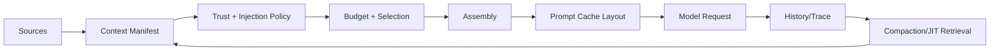

# Context Engineering 总览

模型回答质量不只取决于提示词怎么写，也取决于本轮究竟看到了哪些文件、历史和工具结果。上下文工程就是安排这些材料。先选相关内容，再控制大小、来源和顺序，通常比不断增加提示词更有针对性。

> **版本与资料依据**
> - `last_verified`: `2026-08-24`
> - `version_scope`: `provider-neutral context architecture`
> - `source_type`: `official-docs + engineering synthesis`
> - `stability`: `version-sensitive`

做 Context Engineering，就是为每次模型请求挑选材料：这次需要什么，什么时候放进去，用原文还是其他形式？挑选时要兼顾 token 额度、延迟、成本，以及材料的可信程度。这项工作与长期记忆不同，也不只是编写 system prompt。

## 1. 输入源

- system/developer constraints；
- user goal 与验收条件；
- project instructions、skill manifest；
- tool definitions 与 runtime capability；
- repository/file/search observations；
- session history、working state、checkpoint；
- knowledge retrieval 与 memory retrieval；
- time、identity、permission、environment metadata。

能找到的材料，不必全部放进请求。Context Builder 先列一份 Manifest，记下材料来源、摘要、优先级、信任等级、预计 token 数，以及缓存和截断的处理结果。Assembly 再依据这份记录，把选中的材料按顺序组成消息。

## 2. 三个目标函数

1. **Relevance**：与当前 decision 直接相关，而非“可能有用”。
2. **Reliability**：权威指令、用户数据、外部网页、工具输出有清楚的信任级别。
3. **Efficiency**：稳定前缀利于 prompt cache；动态材料按需检索；旧历史压缩但保留可追溯源。

## 3. 与相邻系统的边界

- Memory 决定保存与召回；Context Engineering 决定本轮是否装入以及如何表达。
- RAG 决定从知识集合检索；Context Engineering 处理结果的预算、引用、信任与位置。
- Harness 调用 Context Builder、保存 manifest 并执行 policy；Harness 组织它，但不替代该领域。
- Model 的 context window 是硬容量；token budget 是应用在容量内分配给不同源的策略。

## 4. 验证

每次请求都应保存一份可脱敏的 manifest。里面记录输入来自哪里、为什么选它、占用多少 token、哪里被截断，还要记录 compaction 版本、cache 命中提示和没有加载的材料。想知道某类材料是否有用，可以做 ablation 测试：去掉它，再比较任务成功率。只看 prompt 长短，判断不了上下文质量。

<!-- evidence-update:2026-10-25 -->

## 从一份工单开始装上下文

假设你保存了一个月的工单记录，但现在只需回答“42 号工单的最近处理进展”。先挑出工单 42 的状态、最近一次处理记录和对应时间，再把问题一起交给模型。这个选择过程就是上下文工程，不需要先搭一个复杂框架。

下一步做一个对照：第一次只传工单正文；第二次再传处理时间。检查回答能否区分“之前的状态”和“现在的状态”。这里的练习目标是发现缺了哪条证据，不是比较哪份提示词更长。

注意框架里的 `context` 可能指程序依赖。Agents SDK 的本地 context 默认不发送给模型，不能因为对象里存了工单就以为模型已经读过它。下文的 Manifest 是本教程建议的追踪方式，不是所有框架都必须提供的标准对象。

### 本节的核验依据

2026-10-25 查阅。下面的链接支持本节的机制说明；练习场景和选型建议是本教程的教学设计。

- [OpenAI Agents SDK：本地 context 与模型 context（固定提交）](https://github.com/openai/openai-agents-python/blob/0dc4cf152bff1f50bdc0e41f28808563406545b2/docs/context.md)
