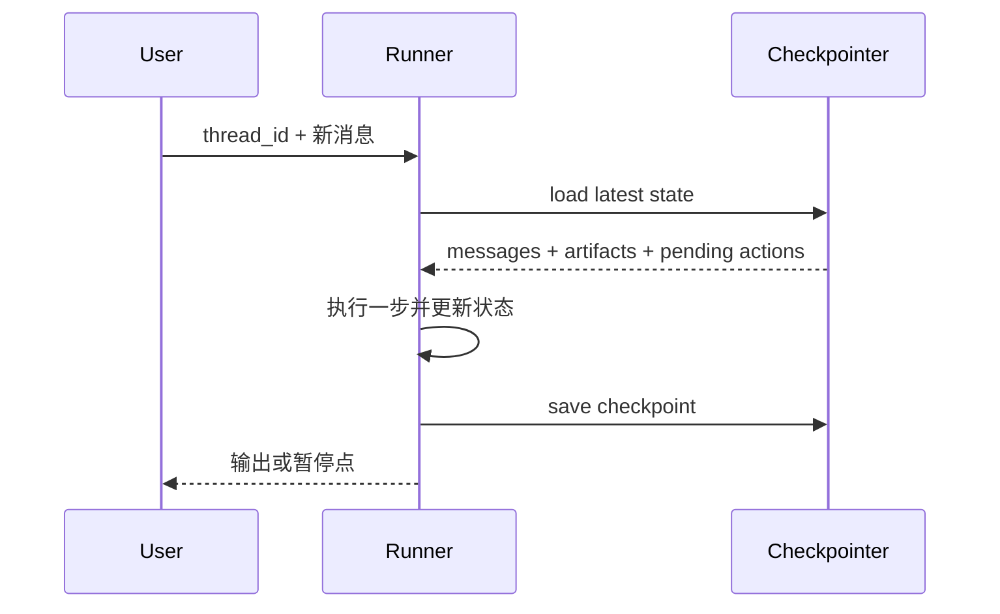

# Short-term Memory：短期状态与会话工作记忆

任务做到一半，需要记住已读文件、失败尝试和待办事项。这些信息主要服务于当前任务，不必全部变成长期记忆。下面介绍怎样把临时状态整理清楚，以及中断后如何继续。

短期记忆服务于当前任务或会话，生命周期从几分钟到一次任务结束。它比原始对话更结构化，典型内容包括当前计划、临时变量、已尝试动作、最近观察、待办、检查点和用户临时偏好。

## 1. 与 Context 的区别

- Context：本轮发给模型的实际输入。
- Short-term Memory：可供 Context Builder 选择的会话状态。

短期记忆可以比当前上下文更大，例如完整工具 trace 保存在数据库中，本轮只装入摘要和最近几步。

## 2. 数据结构

```python group=multi-62f998e556fa label=Python
from dataclasses import dataclass, field

@dataclass
class SessionMemory:
    session_id: str
    goal: str
    plan: list["PlanStep"]
    working_facts: list["Fact"]
    attempts: list["Attempt"]
    evidence_refs: list[str]
    pending_confirmations: list["Confirmation"]
    checkpoint: int
    updated_at: str
```

```rust group=multi-62f998e556fa label=Rust
struct SessionMemory {
    session_id: String,
    goal: String,
    plan: Vec<PlanStep>,
    working_facts: Vec<Fact>,
    attempts: Vec<Attempt>,
    evidence_refs: Vec<String>,
    pending_confirmations: Vec<Confirmation>,
    checkpoint: u64,
    updated_at: String,
}
```

```javascript group=multi-62f998e556fa label=JavaScript
/**
 * @typedef {{
 *   sessionId: string,
 *   goal: string,
 *   plan: PlanStep[],
 *   workingFacts: Fact[],
 *   attempts: Attempt[],
 *   evidenceRefs: string[],
 *   pendingConfirmations: Confirmation[],
 *   checkpoint: number,
 *   updatedAt: string
 * }} SessionMemory
 */
```

```typescript group=multi-62f998e556fa label=TypeScript
type SessionMemory = {
  sessionId: string
  goal: string
  plan: PlanStep[]
  workingFacts: Fact[]
  attempts: Attempt[]
  evidenceRefs: string[]
  pendingConfirmations: Confirmation[]
  checkpoint: number
  updatedAt: string
}
```

`workingFacts` 应带来源和置信状态；`attempts` 保存失败原因与参数指纹；`pendingConfirmations` 防止恢复后跳过确认。

## 3. 写入时机

- 用户明确改变目标；
- 工具产生影响下一步的结果；
- 完成或阻塞一个子任务；
- 做出不可轻易撤销的架构决策；
- 创建检查点；
- Context Compaction 前。

不要把每个 token 或所有自然语言都重复写入状态库。

## 4. 恢复

崩溃恢复时：

1. 读取最后已提交检查点；
2. 核对外部副作用状态；
3. 恢复未完成步骤；
4. 对“执行完成但提交未知”的动作使用幂等键或查询确认；
5. 生成恢复观察，并进入正常 loop。

## 5. 清理

任务结束后，短期状态应：

- 保留必要 trace 和交付证据；
- 将可复用事实提炼为候选长期记忆；
- 丢弃临时 token、重复日志和过期页面状态；
- 按保留策略删除敏感中间数据。

## 6. 测试

- 中途重启能否从检查点继续；
- Compaction 后是否重复已完成工具；
- 并发子任务更新是否覆盖彼此；
- 用户撤销的偏好是否仍残留；
- 过期会话是否按策略清理。


## 7. 短期记忆的工程形态：Thread State + Checkpoint

短期记忆通常绑定 `thread_id`，包含消息、当前计划、工具结果、上传文件引用、待审批动作和阶段性产物。每个关键步骤写 checkpoint，恢复时从最后一个一致状态继续。



消息历史不是短期记忆的全部。若只保存文本而不保存 tool call ID、未完成事务和 artifact 版本，恢复后容易重复执行动作或丢失任务进度。

## 8. 长会话治理

常用策略包括滑动窗口、按相关性选择、结构化摘要和把旧产物移到外部存储。摘要需要可增量更新，并保留“已确认事实 / 未解决问题 / 已执行副作用 / 证据引用”。对被压缩掉的原始事件保存 trace 指针，以便审计和调试。

参考：[LangGraph Memory 概览](https://docs.langchain.com/oss/python/concepts/memory)。

<!-- evidence-update:2026-10-25 -->

## 重启测试，比聊天轮数更能说明问题

先在会话 A 写下“工单 42 已检查到附件”，再读回。随后换成会话 B，最后重启进程再回到 A。三个动作分别检验同一会话连续性、会话隔离和持久化。

Deep Agents 的 StateBackend 把文件放进图状态，作用域属于当前 thread；是否能跨进程保存，还取决于你配置的 checkpointer。名字里有 Memory 或 state，不代表服务重启后数据一定还在。

测试中让每个会话使用不同 ID，并记录读到了哪个版本。不要把数据库里存着全量历史与模型本轮能看见哪些消息混成一件事。

### 本节的核验依据

2026-10-25 查阅。下面的链接支持本节的机制说明；练习场景和选型建议是本教程的教学设计。

- [Deep Agents：thread 内的文件状态（固定源码）](https://github.com/langchain-ai/deepagents/blob/793ac5af081079977616fe1925b09670871121d3/libs/deepagents/deepagents/backends/state.py)
- [LangGraph：Persistence](https://docs.langchain.com/oss/python/langgraph/persistence)
