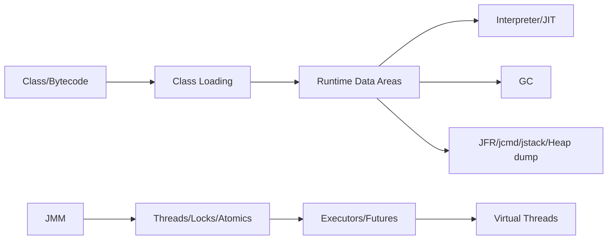

# JVM 与并发：从运行时到生产诊断

服务变慢或内存不断上涨时，猜一个 JVM 参数通常不是好的起点。先保留运行条件，再收集线程、内存和 GC 的信息。本节给出学习顺序，让后面的诊断工具都有一个具体要回答的问题。

> **版本与资料依据**
> - `last_verified`: `2026-08-24`
> - `version_scope`: `JDK 25 baseline; JDK 26 feature awareness`
> - `source_type`: `JVMS + OpenJDK JEP + JDK docs`
> - `stability`: `version-sensitive`

## 学习问题

1. Java source 如何成为 class file，class loader 的 identity 为何包含 loader？
2. heap、thread stack、metaspace、code cache 各保存什么，OOM/StackOverflow 如何区分？
3. JIT 依据 profile 优化后为何可能 deoptimize？
4. GC 的 pause、throughput、latency 与 allocation rate 如何共同分析？
5. JMM 的 happens-before 如何约束可见性与排序？`volatile` 为什么不自动让复合操作原子？
6. platform thread、virtual thread、async API、reactive stream 分别是什么抽象？
7. 出现 CPU、停顿、死锁、内存增长时，选择 JFR、jcmd、jstack、heap dump 的依据是什么？

## 生产原则

先测量再调参。保留 JVM/JDK/container/GC flags、负载、warm-up、JFR 和 GC log。不要从一次 heap dump 推断长期趋势，也不要在未理解 workload 时复制“最佳 JVM 参数”。

<!-- evidence-update:2026-10-25 -->

## 先用一个慢请求练习诊断

准备一个自己能复现的慢接口，记下请求时间和进程 ID。先用 `jcmd <pid> help` 看目标 JVM 支持哪些诊断命令，再按帮助收集短时间的 JFR 记录。别一上来就把所有参数改掉。

读记录时先区分两种现象：线程持续占用 CPU，还是大量时间在等待锁或 I/O？然后只改一个假设相关的因素，重复同样的请求。`jcmd` 的命令各有影响级别，堆转储尤其不能当成没有成本的日常探针；先在练习服务操作，再安排生产采样。

### 本节的核验依据

2026-10-25 查阅。下面的链接支持本节的机制说明；练习场景和选型建议是本教程的教学设计。

- [JDK 25：jcmd 诊断命令与影响说明](https://docs.oracle.com/en/java/javase/25/docs/specs/man/jcmd.html)
