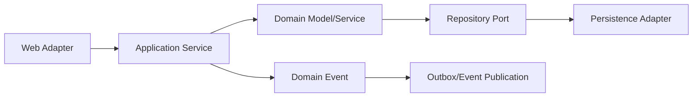

# 应用架构与模块化单体：先学会维护一个单体

当订单逻辑散落在很多包里，改一个字段都要搜索半个项目时，就该重新考虑代码如何组织。模块化首先是让相关业务待在一起，并限制互相访问的方式；它不要求你立刻拆服务。

> **版本与资料依据**
> - `last_verified`: `2026-08-24`
> - `version_scope`: `Spring Modulith current concepts`
> - `source_type`: `Spring official docs + architecture literature`
> - `stability`: `version-sensitive`

核心问题不是记 DDD 名词，而是：**业务边界如何划分，使代码、事务、测试和团队协作长期可维护**。

## 学习顺序

1. package by layer 与 package by feature 的依赖差异；
2. domain model、bounded context 基础与语言边界；
3. application service 编排 use case，domain service 放置跨实体规则；
4. repository 是领域所需持久化边界，不等于每表一个 DAO；
5. ports & adapters 让业务规则不依赖 HTTP/DB；
6. module verification 与 module integration test；
7. transaction boundary、domain event、outbox、idempotency；
8. 用 observability 看模块交互，再决定是否拆服务。

<!-- evidence-update:2026-10-25 -->

## 先画谁能访问谁，再画目录

从订单、库存两个功能开始：订单模块可以请求库存预留，但不能随意修改库存内部表或读取它的内部仓库类。先列出允许的调用，再把需要公开的参数和结果写成接口。

练习时故意增加一个反向依赖，让库存也直接依赖订单内部实现，观察模块验证是否拒绝。练习的重点是把约定变成可检查的规则；一个漂亮的目录树不会自动阻止跨模块访问。

### 本节的核验依据

2026-10-25 查阅。下面的链接支持本节的机制说明；练习场景和选型建议是本教程的教学设计。

- [Spring Modulith：模块验证规则](https://docs.spring.io/spring-modulith/reference/verification.html)
